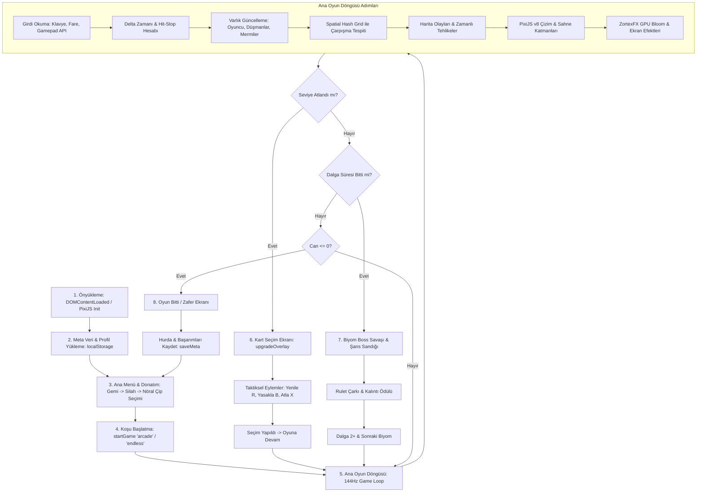

# ZORTEX: CYBER SURVIVOR — GENEL PROJE RAPORU, KOD AKIŞI VE AI DEVİR KILAVUZU
> **Hedef Kitle:** Başka bir Yapay Zeka (AI / LLM) veya Geliştirici.  
> **Tarih:** 14 Ekim 2026  
> **Durum:** Kararlı, 144 FPS Doğrulandı, Sıfır Konsol Hatası.

---

## 1. YÖNETİCİ ÖZETİ VE OYUN KİMLİĞİ

- **Oyun Adı:** ZORTEX: Cyber Survivor
- **Tür:** Yüksek tempolu, 144Hz, Cyberpunk temalı Roguelike Bullet-Heaven / Survivors arcade aksiyon oyunu.
- **Motor & Teknoloji:** 
  - **PixiJS v8.x** UMD (`pixi.v8.min.js`), WebGL2 / WebGPU-ready mimari.
  - **Web Audio API**: Tamamen sıfırdan sentetik prosedürel ses motoru (SFX) + dinamik müzik ve ses foley sistemi.
  - **Saf JavaScript (ES6+)**: Çalışma zamanında (runtime) harici paket yöneticisi (npm/webpack/vite) veya CDN bağımlılığı gerektirmez, %100 çevrimdışı (offline) çalışır.
- **Performans Bütçesi:** 
  - Hedef: 144 FPS (kare süresi: ~6.94 ms, p99 < 8.0 ms, sıcak çatışmalarda >20 ms ani takılma sıfır).
  - Bellek: Hot loop döngülerinde **Zero-GC** (Sıfır Çöp Toplama) nesne havuzu (Object Pool) disiplini.

---

## 2. DOSYA VE DİZİN MİMARİSİ

```
c:/Users/user/Desktop/zort/
├── index.html                   # Çekirdek Oyun: Oyuncu, Silahlar, Düşmanlar, Döngü, Arayüz (19.038 satır)
├── js/
│   ├── audio/
│   │   ├── cyber_audio_engine.js    # Prosedürel Web Audio API synthesizer (lazer, patlama, foley)
│   │   └── audio_broker.js          # Ses önceliklendirme, sidechain ducking, ses bütçesi yöneticisi
│   ├── core/
│   │   ├── asset_loader_core.js     # Sprite ve doku yükleyici, yedek prosedürel doku üreticisi
│   │   ├── camera_system.js         # Yumuşak kamera sönümlemesi, ekran sarsıntısı (trauma shake)
│   │   ├── daily_run_rng.js         # Günlük yarış (Daily Run) için tohumlanmış mulberry32 PRNG
│   │   ├── localization.js          # TR / EN / ES / DE 4 dil desteği ve çalışma zamanı i18n yöneticisi
│   │   ├── object_pool.js           # Mermiler, parçacıklar ve hasar metinleri için GC-Free havuz
│   │   └── profiler_system.js       # Canlı kare süresi, p99 ve donma telemetri profilleyicisi
│   ├── fx/
│   │   └── zortex_fx.js             # GPU Post-Process: Bloom, Nebula, Şok Dalgaları, Görelilik Karadeliği (2.367 satır)
│   └── gameplay/
│       ├── biome_bosses.js          # Biyom geçişleri, özel boss davranışları ve çok fazlı dövüşler
│       ├── enemy_registry.js        # Temel düşman tanımları ve dalga çarpanları
│       ├── events_enemies_system.js # 12 özel fasetli siber düşman + harita olayları (meteor, plazma fırtınası)
│       ├── fusion_sector_system.js  # 11 silah evrimi ve çiftli füzyon birleşim motoru
│       ├── gamemode_audio_system.js # Siber Tehlike (Pact of Punishment Heat), Sonsuz Mod, Günlük Mod
│       ├── inventory_chest_system.js# 12 slotlu envanter, şans sandığı rulet çarkı, kalıntı etkileri
│       ├── skill_mutations_nemesis.js# Düşman mutasyon sistemi ve Nemesis yapay zeka rakibi
│       ├── threat_system.js         # Elit tehdit algılayıcısı ve dinamik karşılaşma zorluğu
│       └── zortex_meta_progression.js # 10 Gemi Şasisi, 13 Başlangıç Silahı, 16 Nöral Çip & Sıralı Donatım Sihirbazı
├── vendor/                      # Tamamen yerel kütüphaneler (tweakpane, pixi-filters)
├── pixi.v8.min.js               # PixiJS v8 UMD paketi
├── assets/                      # Yerel ses efektleri ve sprite dokuları
├── docs/                        # Mimari dökümanlar (CODEBASE_MAP.md, RENDER_PIPELINE.md, vb.)
├── scripts/                     # Kanonik test paketi (sim_gate.py, gfx_probe.py, bench_b2.py, update_codebase_map.mjs)
├── AGENTS.md                    # Yapay zeka ajan anayasası ve kısıtlamaları
└── oyna.bat                     # Oyunu yerel HTTP sunucusu ile başlatan bat dosyası
```

---

## 3. KOD AKIŞI VE YAŞAM DÖNGÜSÜ (EXECUTION FLOW)



### Aşama Detayları:
1. **Önyükleme (Bootstrapping):**
   - `index.html` yüklenir.
   - `AudioEngine` ses mimarisini ve Web Audio API bağlamını oluşturur.
   - `PIXI.Application` başlatılır (WebGL2 / WebGPU-ready).
   - Sahne katmanları (`backgroundLayer`, `entitiesLayer`, `playerLayer`, `emissiveLayer`, `overlayTextLayer`) `worldContainer` altına bağlanır.
   - `loadMeta()`, `getActiveProfile()` çağrılarak kalıcı ilerleme ve ayarlar yüklenir.
   - `initLocalization()` dil tablosunu eşler (TR / EN).

2. **Menü & Donatım Sihirbazı (Loadout Wizard Phase - 20 Minutes Till Dawn Stili):**
   - `gameState = 'MENU'`.
   - Oyuncu "SEFERİ DONAT (LOADOUT BAY)" modaline girer (`#runSetupOverlay`):
     - **Adım 1: Gemi Şasisi Seçimi:** 10 gemiden biri seçilir (Interceptor, Titan, Spectre, Valkyrie, Dreadnought, Chronos, Tempest, Mirage, Behemoth, Solarion). Seçim sonrası "SEÇ & SİLAHA GEÇ ➔" butonuyla otomatik olarak silah sekmesine geçilir.
     - **Adım 2: Silah Donanımı Seçimi:** 13 başlangıç silahından biri kuşanılır (Blaster, Scatter, Railgun, Plasma, Rocket, Laser, Drone, Cryo, Flamer, Arc, Saw, Tesla, Swarm). Seçim sonrası "SEÇ & NÖRALE GEÇ ➔" ile çip soketlerine geçilir.
     - **Adım 3: Nöral Matris:** Teknoloji ağacından açılan 0-4 sokete 16 farklı nöral çipten takviyeler yerleştirilir.
     - **Adım 4: Seferi Başlat:** "🚀 SEFERİ BAŞLAT [ENTER]" butonu ile tam donanımlı koşu başlar.
   - Seçilen mod: Arcade (7 Dalga + Biyom Bossları), Sonsuz (Endless), Günlük (Daily Run), Siber Tehlike (Pact of Punishment Heat ayarı).

3. **Koşu Başlatma (`startGame(mode)`):**
   - Oyuncu nesnesi (`Player`) sıfırlanır, seçilen gemi, hız modifikatörleri ve başlangıç silahı yüklenir.
   - Oyuncunun taban hızı `player.baseSpeed = 4.2` px/frame olarak normalize edilir.
   - `SpatialGrid` (uzamsal ızgara) temizlenir.
   - Mermi ve parçacık havuzları (`ObjectPool`) ısıtılır (*pre-warmed*).
   - `wave = 1`, `gameState = 'PLAYING'`.

4. **Ana Oyun Döngüsü (`gameLoop(timestamp)`):**
   - **Girdi:** Klavye (WASD / Oklar), Fare veya Gamepad API (`navigator.getGamepads()`) taranır. Çift analog çubuk ve titreşim (*rumble haptics*) desteklenir.
   - **Zamanlama:** `dt = Math.min(rawDt, 0.05)` ile sınırlandırılır. Vuruş hissi (*hit-stop*) varsa mikro dondurma uygulanır.
   - **Oyuncu:** Hareket, atılma (*dash*), kalkan şarjı, sınıfına özel reaktör ve plazma kondüitleri güncellenir.
   - **Silahlar:** `WeaponManager` aktif silahların ve evrimlerin bekleme sürelerini yönetir, mermi ateşler.
   - **Çarpışmalar:** `SpatialGrid` üzerinden $O(1)$ karmaşıklıkta mermi-düşman ve oyuncu-cevher mesafeleri kontrol edilir.
   - **Düşmanlar:** Sürü zekası, menzilli atıcılar, 12 özel siber düşman sınıfı ve biyom bossları durum makinelerini çalıştırır.
   - **Olaylar:** `timedEventsManager` meteor yağmurları, plazma fırtınaları ve dünya-koordinatlı görelilik karadeliklerini yönetir.
   - **Görselleştirme:** PixiJS v8 render ağacı güncellenir. Emissive katman üzerinde `ZortexFX.renderPostProcess()` (AdvancedBloom, renk sapması, kenar parıltısı) uygulanır.

5. **Geliştirme & Kart Seçimi (`player.levelUp()`):**
   - `gameState = 'UPGRADE'`.
   - 3 adet kart rastgele seçilir (oyuncunun yasakladığı `player.bannedCardIds` havuzdan elenir).
   - **Taktiksel Kart Eylem Çubuğu:**
     - 🎲 **Yenile [R] (2 hak):** Yeni 3 kart çeker.
     - 🚫 **Yasakla [B] (1 hak):** Seçili kartı koşudan kalıcı olarak yasaklar.
     - ⏩ **Atla [X] (Sınırsız):** Seçimi atlayarak anında **+25 Hurda** ve **+15 XP** verir.
   - Gamepad kısayolları: `X` (Yenile), `Y` (Yasakla), `B` (Atla).

6. **Biyom Bossları & Şans Sandığı & Dalga Geçişi:**
   - Dalga süresi dolduğunda alarm sirenleri çalar ve biyom bossu doğar (`boss.isBoss = true`, `boss.type = 'boss'`, `boss.bossType = 'omega_dreadnought'`).
   - Boss öldüğünde `window.ChestSystem.spawnChest(boss.x, boss.y)` ile şans sandığı düşer.
   - `EnemyBase.prototype.die()` tetiklendiğinde `bossSpawned = false` olur, `wave++` ile bir sonraki dalgaya geçilir ve `WaveManager` yeni dalga düşmanlarını doğurmaya başlar.
   - Sandık açıldığında 12 slotlu envanter için rulet çarkı döner ve kalıntı (*relic*) kazanılır.

7. **Oyun Sonu / Zafer:**
   - Oyuncu öldüğünde (`player.hp <= 0`) veya 7. dalga bossu yenildiğinde oyun biter.
   - Kazanılan Hurda (`meta.scrap`) kalıcı ilerleme için kaydedilir (`saveMeta()`).

---

## 4. ALT SİSTEMLER VE DERİNLEMESİNE İNCELEME

### A. Görelilik Karadeliği (Relativistic Black Hole)
- **Konum:** `js/gameplay/events_enemies_system.js` & `index.html`
- **Tasarım:** Ekran-koordinatlı filtre yerine dünya-koordinatlarında (`pixiHazardsBelow` katmanında) çalışan 100% senkronize GPU accretion disk mimarisi.
- **Özellikler:** 8 kollu logaritmik kavisler, Doppler beaming (yaklaşırken kehribar/beyaz, uzaklaşırken çivit mavisi), 4 bant kütleçekimsel mercek korona halkası, olay ufku ve tekillik. Sıfır kamera kayması, sıfır kare kesilmesi.

### B. Özel Düşman Revizyonu (12 Siber Düşman Sınıfı)
- **Konum:** `js/gameplay/events_enemies_system.js`
- Düz tek renkli daireler yerine fasetli cyberpunk zırh gövdeleri ile donatılmıştır:
  1. `HealerDroneEnemy`: Zümrüt altıgen + 3 yörünge nano-uydusu + medikal artı çekirdek.
  2. `MineDropperEnemy`: Sekizgen zırh + sarı-siyah ikaz şeritleri + mayın bacası.
  3. `SplitterEnemy`: 7 köşeli kırık jeot kristali + çatlak çizgileri + rezonans çekirdeği.
  4. `GoldDroneEnemy`: Altın ok ucu + beyaz mücevher + çift iyon jeti.
  5. `SniperDroneEnemy`: İğne burunlu gövde + raylı kanatçıklar + yakut nişangah lazeri.
  6. `ShieldGeneratorEnemy`: Elmas kale zırhı + 3 projektör pilonu + kalkan kubbesi.
  7. `CoreEaterEnemy`: Mekanik kıskaçlar + saydam kristal depo karnı.
  8. `SwarmQueenEnemy` & `SwarmDroneChild`: Taçlı ana gemi + 16 dönen eskort iğnesi.
  9. `BigPhantomEnemy`: F-117 hayalet uçak gövdesi + holografik tarama çizgileri.
  10. `EchoEnemy`: Oyuncunun negatif siber ikizi + kromatik gölge kayması.
  11. `BlinkStalkerEnemy`: Peygamber devesi suikastçı + neon tırpan bıçakları + ışınlanma uyarısı.
- **Isı Ölçeklemesi:** Tüm sınıflar `ZortexGameModes.applyHeatToEnemy(this)` ile Pact of Punishment (Siber Tehlike) can ve hız çarpanlarını dinamik olarak alır.

### C. Siber Füzyon Kodeksi (Codex) & Keşif Sistemi
- **Konum:** `index.html` (`FUSION_CODEX_ENTRIES`)
- 11 adet füzyon şeması (Blaster, Plazma, Raygun, Gatling vb. evrimleri).
- `localStorage` tabanlı kalıcı keşif mekanizması: Koşuda henüz birleştirilmemiş füzyonlar `??? [BİLİNMEYEN EVRİM]` başlığı ve kilitli şemayla görünür. İlgili silah seviye 8 yapılıp evrimleştirildiğinde kalıcı olarak açılır.

### D. Geometrik Düşmanlar (2.5D Model & Kinematik İyileştirme) ve XP Dengelemesi
- **Konum:** `index.html` (`initPixiTextures`, `EnemyBase.update`, `pixiFlameTrailGraphics`, `calculateNextLevelXp`)
- **2.5D Düşman Gövdeleri:** Üçgen (Scout, Swarm, Kamikaze) ve çokgen (Heavy, Tank, Shooter, Phantom) modelleri Retina (`resolution: 2`) prosedürel kaplamalarla donatıldı. Çok katmanlı pahlı titanyum zırh panelleri, speküler kenar ışıkları, siklop hedefleme sensörleri ve parlayan reaktör çekirdekleri eklendi.
- **Kinematik Dönüş & Darbe Hissi:** Açısal hıza bağlı yumuşak viraj yatması (`rollTilt` ±14°), vuruş esnemesi (`bankSquash`) ve motor arkalarında çift/dörtlü reaktif plazma alev püskürmesi entegre edildi.
- **Kademeli XP ve Seviye Eğrisi:** Formül $XP_{next} = 25 + 18L + 4.5L^2$ (Seviye 1: 48, Seviye 5: 228, Seviye 10: 655, Seviye 20: 2185 - Kümülatif: 15.015 XP) olarak ayarlandı.

### E. 10 Gemi Şasisi, 13 Başlangıç Silahı, 16 Nöral Çip Meta-Progression
- **Konum:** `js/gameplay/zortex_meta_progression.js`
- **10 Gemi Şasisi:**
  1. `interceptor`: Hız & atılma odaklı hafif avcı.
  2. `titan`: Zırh ve alan hasarı odaklı ağır kruvazör.
  3. `spectre`: Gizlilik, kamuflaj ve yüksek kritik vuruş uzmanı.
  4. `valkyrie`: Kalkan şarjı ve sürekli lazer taarruzu.
  5. `dreadnought`: Aşırı dayanıklılık ve devasa balistik taretler.
  6. `chronos`: Zaman bükme ve yetenek bekleme süresi azaltma.
  7. `tempest`: Fırtına mermi hızı ve çoklu saçılma.
  8. `mirage`: Holografik yanılsama ve mermilerden sıyrılma.
  9. `behemoth`: Koçbaşı gövde zırhı ve doğrudan çarpışma hasarı.
  10. `solarion`: Güneş plazması kondüitleri ve sürekli can yenilenmesi.
- **13 Başlangıç Silahı:** Blaster, Scatter, Railgun, Plasma, Rocket, Laser, Drone, Cryo, Flamer, Arc, Saw, Tesla, Swarm. Her silahın hasar, atış menzili, soğuma süresi ve mermi rengi özelleştirilmiştir.
- **16 Nöral Çip:**
  - Overclock, Adrenaline, Aegis, Magnet, Greed, Crit, Ricochet, Swiftness, Nanites, Vampirism, Forcefield, Berserk, Sniper, Nova, Battery, Momentum.
- **Sıralı Donatım Sihirbazı (Step-by-Step Loadout Flow):**
  - Gemi Seçimi (`#rsoSelectAndGoBtn`) ➔ Silah Seçimi (`#rsoSelectWAndGoBtn`) ➔ Nöral Çip Soketleri ➔ Seferi Başlat (`#runSetupLaunchBtn`).
  - Dinamik navigasyon ve geriye dönüş düğmeleri (`updateFooterNavigation`) ile kusursuz UX.

### F. Dalga 1 Boss Ölümü & Dalga 2 Geçiş Sözleşmesi (Wave Transition Fix)
- **Konum:** `js/gameplay/biome_bosses.js` & `index.html`
- **Sorun:** Biyom bossu yaratılırken `boss.type` özelliğinin doğrudan `'omega_dreadnought'` vb. atanması, çekirdek `EnemyBase.prototype.die()` içindeki `if (this.type === 'boss')` kontrolünün başarısız olmasına yol açıyordu. Sonuçta `bossSpawned = false` ve `wave++` tetiklenmiyor, oyun Dalga 1 bossu öldükten sonra Dalga 2'ye geçemiyordu.
- **Çözüm:** `biome_bosses.js` içinde `boss.isBoss = true` ve `boss.type = 'boss'` kesin sözleşmesi güvenceye alındı; özel arketip `boss.bossType` içinde saklandı. `index.html` üzerindeki tüm `die`, `takeDamage`, `draw` ve `update` çağrıları `(this.type === 'boss' || this.isBoss || Boolean(this.bossType))` olarak güncellendi. Boss yenildiğinde anında `window.ChestSystem.spawnChest` sandık bırakır ve Dalga 2 düşmanları kesintisiz doğar.

### G. Oyuncu Taban Hızı Normalizasyonu (Player Movement Scale Fix)
- **Konum:** `js/gameplay/zortex_meta_progression.js` (Satır 1795)
- **Sorun:** Kodda `player.speed = (player.baseSpeed || 320) * ship.speedMod` kullanılmıştı. Oysa oyun motoru `this.x += moveX * curSpeed * dtNorm` formülüyle piksel/kare ölçeğinde (~4.2 px/frame) çalışır. Tanımsız `baseSpeed` nedeniyle 320 atandığında gemi 76 kat aşırı hızlanarak kontrol edilemez hale geliyordu.
- **Çözüm:** Taban hız `const baseSpeed = 4.2; player.baseSpeed = baseSpeed;` olarak normalize edildi. Titan (`3.57 px/frame`) ve Interceptor (`5.25 px/frame`) dahil tüm gemiler yumuşak ve akıcı hareket dinamiklerine kavuştu.

---

## 5. GELİŞTİRİCİ / YAPAY ZEKA İÇİN ALTIN KURALLAR (STRICT CONSTRAINTS)

Bu projeyi düzenleyecek bir sonraki yapay zekanın uyması gereken **kesin kurallar**:

1. **CRLF Satır Sonu Disiplini:**
   - Projedeki tüm dosyalar (özellikle 19.000+ satırlık `index.html`) kesinlikle **CRLF (`
`)** satır sonuna sahiptir.
   - Değişiklik yaparken LF karmaşası yaratılmamalı, CRLF biçimi %100 korunmalıdır.

2. **Monolitik Dosya Kuralı (index.html):**
   - **ASLA** `index.html` dosyasının tamamını yeniden oluşturmaya veya tek seferde baştan yazmaya kalkışmayın (bağlam sınırı aşımı ve döngü bozulmasına yol açar).
   - Değişiklikler için hedef satır bloklarını `docs/CODEBASE_MAP.md` üzerinden tespit edip cerrahi (surgical) blok değişimi yapın.

3. **PixiJS v8 Sentaks Zorunluluğu:**
   - Proje **PixiJS v8** kullanır. PixiJS v7 API'leri (`new Filter(vert, frag)`, `lineStyle(0)`, açık bırakılan stroke yolları) batch sızıntılarına veya çökmelere yol açar.
   - Çizimlerde açık yol bırakmayın: Her zaman `g.circle(x, y, r); g.stroke({...}); g.closePath(); g.endFill();` yapısını kullanın.

4. **Zero-GC & 144 FPS Bütçesi:**
   - Saniyede yüzlerce mermi, parçacık ve hasar metni üretilir.
   - `update()` veya `draw()` fonksiyonlarında `new Array()`, `new Object()` gibi çöp toplayıcıyı (Garbage Collector) tetikleyecek tahsisler yapmayın. `ObjectPool` kullanın.

5. **Gerileme Testi (Regression Testing):**
   - Herhangi bir sistem değişikliğinden sonra `python scripts/verify_zortex_overhaul.py` ve `python scripts/run_full_regression.py` çalıştırılarak tüm testler %100 başarılı doğrulanmalıdır.

---

## 6. TEST VE DOĞRULAMA KILAVUZU

Proje kök dizininde hazır çalışan test otomasyonları:
- `python scripts/verify_zortex_overhaul.py` : 10 adımlı tam kapsamlı doğrulama (10 Gemi, 13 Silah, 16 Çip, Dalga 1 Boss Ölümü, Sandık Düşüşü, Dalga 2 Geçişi, Sıralı Donatım Sihirbazı UX).
- `python scripts/run_full_regression.py` : Ana menü, hangar, kart yükseltme modali, duraklatma menüsü ve 7 dalgalık savaş simülasyonunu çalıştırır; FPS ve konsol hatalarını doğrular.
- `oyna.bat` : Yerel Python HTTP sunucusu açar ve varsayılan tarayıcıda oyunu başlatır.
